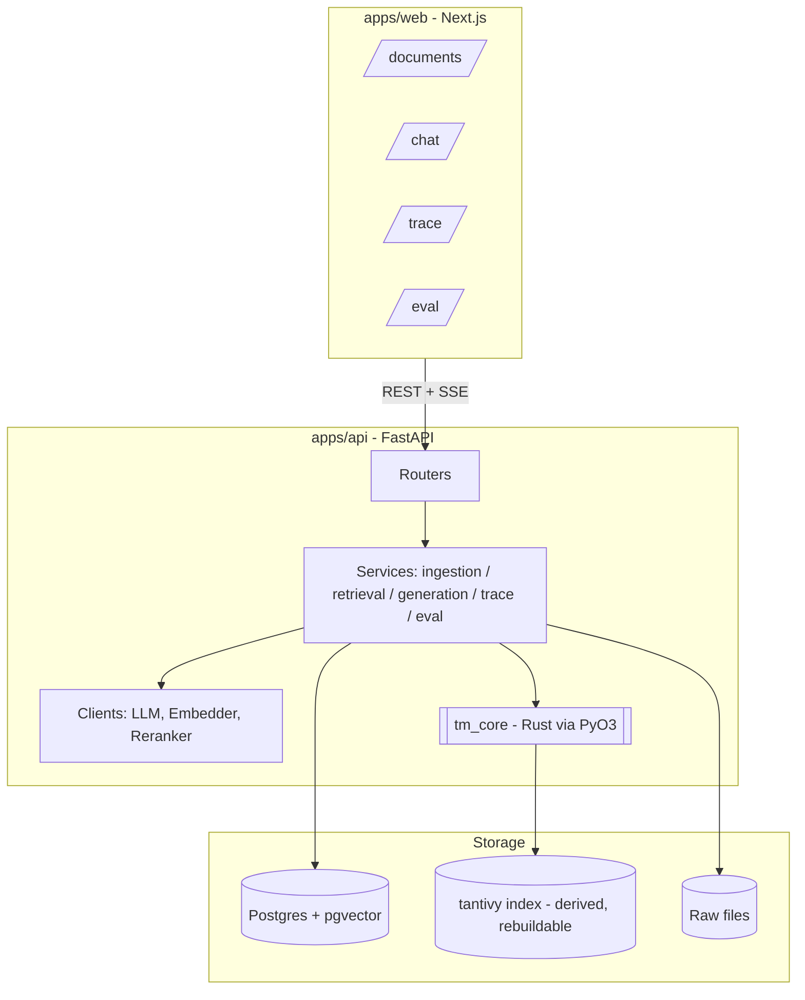
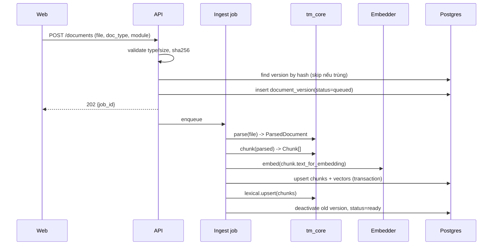
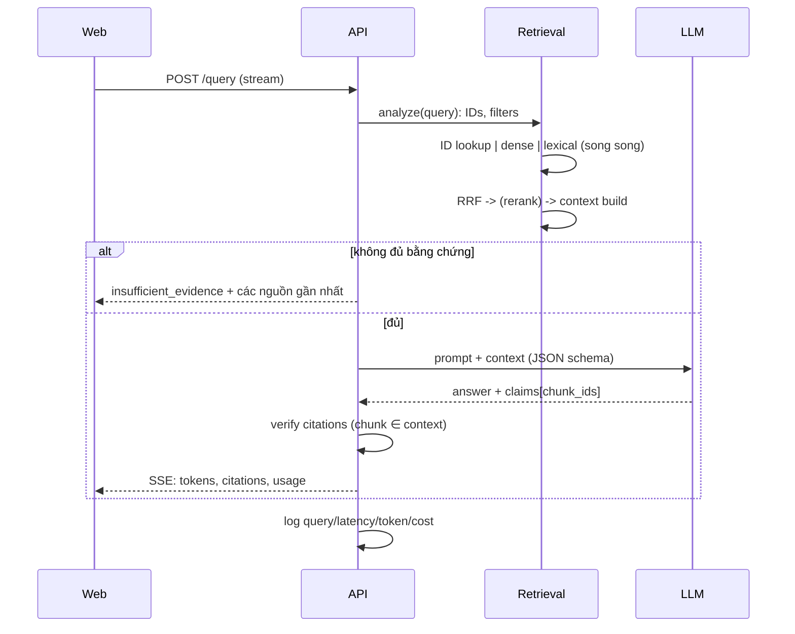

# Kiến trúc TestMind AI (v2: Next.js + Python + Rust core)

## 1. Định vị sản phẩm

**TestMind AI = Requirement–Test Traceability Assistant** cho QA/QC.
Trọng tâm: truy xuất bằng chứng từ BRD/test case/bug có citation chính xác, ánh xạ requirement ↔ test case,
từ chối khi thiếu căn cứ, và **đo được chất lượng**.

Ngoài scope MVP: Bug-vs-Not-a-Bug, sinh test case hàng loạt, auth đa người dùng, OCR PDF scan.

## 2. Quyết định công nghệ (ADR tóm tắt)

| # | Quyết định | Lựa chọn | Lý do chính | Đánh đổi |
|---|---|---|---|---|
| 1 | Frontend | **Next.js (App Router, TS, Tailwind, shadcn/ui)** | Người dùng đã chốt; UI chuyên nghiệp cho portfolio | Tốn thời gian UI hơn Streamlit |
| 2 | Backend | **FastAPI (Python 3.12)** | Hệ sinh thái embedding/rerank/eval đều Python | Hiệu năng CPU thấp hơn Rust (không phải nút thắt) |
| 3 | Rust | **`tm-core` (PyO3/maturin), gọi in-process** | Chỉ đưa vào chỗ CPU-bound và đo được (xem mục 5) | Thêm toolchain; phải giữ đồng bộ interface |
| 4 | DB | **PostgreSQL 16 + pgvector** | Một nơi cho metadata, vector, version, log, eval | pgvector không native sparse |
| 5 | Lexical search | Python reference → **tantivy (trong tm-core)** | BM25 thật, tokenizer tuỳ biến cho tiếng Việt | Index phụ cần rebuild được |
| 6 | Embedding | **BGE-M3** (local, dense) | Đa ngôn ngữ, gồm tiếng Việt | Cần RAM/CPU; benchmark trên dữ liệu thật |
| 7 | Reranker | bge-reranker-v2-m3 (tuỳ chọn, Phase 2) | Chỉ giữ nếu eval chứng minh có lợi | Latency |
| 8 | LLM | **DeepSeek-V4.1-Flash** qua W&B Inference (`https://api.inference.wandb.ai/v1`) | Client tương thích OpenAI | Ngân sách ngày chưa đặt |
| 9 | Framework RAG | **Không dùng** (tự viết mỏng) | Kiểm soát + giải thích được khi phỏng vấn | Viết nhiều hơn |
| 10 | Deploy | Docker Compose | Đủ cho solo project | Không autoscale |

## 3. Sơ đồ tổng thể

**Nguồn sự thật (source of truth) = Postgres + raw files.** Index tantivy chỉ là dữ liệu dẫn xuất:
mất thì `make reindex` dựng lại từ bảng `chunks`.

## 4. Thành phần và trách nhiệm

| Thành phần | Trách nhiệm | KHÔNG làm |
|---|---|---|
| `apps/web` | UI, gọi API, hiển thị citation/trace/eval | Gọi LLM/DB trực tiếp, chứa logic RAG |
| `routers` | Validate, auth/quota, gọi service | Logic nghiệp vụ |
| `services/ingestion` | Điều phối parse → chunk → embed → upsert, versioning | Parse thủ công chi tiết (giao cho parser/tm_core) |
| `services/retrieval` | Query analysis, dense+lexical, RRF, rerank, context build | Gọi LLM sinh câu trả lời |
| `services/generation` | Prompt, gọi LLM, kiểm tra citation | Truy xuất |
| `services/trace` | Req→Test case mapping, coverage gợi ý | Kết luận "đủ coverage" |
| `services/eval` | Chạy dataset, tính metric, lưu run | Sửa dataset |
| `tm_core` (Rust) | Parse xlsx/csv/md (+docx sau), chunking, BM25, RRF, metrics | Gọi mạng, LLM, DB |

## 5. Rust: dùng ở đâu, vì sao, và kỷ luật đo

**Sự thật về nút thắt:** một truy vấn Q&A tốn thời gian chủ yếu ở **LLM (giây)** và **embedding (trăm ms)**.
Viết lại web server bằng Rust gần như không đổi trải nghiệm. Vì vậy Rust chỉ đặt ở phần CPU-bound, thuần tính toán:

| Module trong `tm-core` | Tại sao Rust hợp lý | Ghi chú |
|---|---|---|
| `lexical` (tantivy) | BM25 thật, index nhanh, tokenizer tuỳ biến (bigram tiếng Việt) | Giá trị lớn nhất, ưu tiên làm đầu |
| `parse::xlsx/csv` (calamine, csv) | File Excel test case lớn: đọc nhanh, ít RAM | Python `openpyxl` là baseline để so |
| `parse::md` (pulldown-cmark) | Parse cấu trúc heading nhanh | Nhỏ |
| `chunk` | Chunking theo cấu trúc, đếm token | Dùng chung tokenizers (đã là Rust) |
| `fusion` | RRF, dedupe, context trimming | Nhỏ, dễ test |
| `metrics` | Recall@K, MRR, nDCG | Chạy eval nhanh, kết quả tất định |
| `parse::docx` | **Hoãn**: crate Rust cho DOCX chưa chín bằng `python-docx` | Chỉ port nếu benchmark chứng minh cần |

**Kỷ luật (bắt buộc):**
1. **Làm bản Python tham chiếu trước** sau các interface (`LexicalIndex`, `Chunker`, `SpreadsheetParser`).
2. Viết **benchmark** (`bench/`) so Python vs Rust trên cùng dữ liệu: thời gian index, p50/p95 truy vấn, RAM.
3. **Chỉ giữ Rust ở module nào cải thiện đo được** (ghi số thật vào `bench/results/`, không ước đoán).
4. Chất lượng retrieval (Recall/MRR) của Rust phải **không thấp hơn** bản Python (test tương đương).

Kết quả cuối cùng (kể cả "Rust không đáng ở module X") là một điểm nhấn kỹ thuật thật cho CV.

Giao diện Rust↔Python chi tiết: `docs/specs/07-rust-core.md`.

## 6. Data flow

### Flow A — Upload → Indexing

### Flow B — Hỏi đáp

## 7. Data model (Postgres)

| Bảng | Cột chính |
|---|---|
| `documents` | id, name, doc_type (`brd`/`srs`/`testcase`/`bug`/`api`/`process`), module, created_at |
| `document_versions` | id, document_id, version, content_hash, is_active, status, error, uploaded_at |
| `chunks` | id (deterministic), version_id, ordinal, text, text_for_embedding, section_path, loc (JSONB: page/sheet/row/cell/paragraph_idx), requirement_ids text[], token_count, embedding vector(1024), embedding_model, is_active |
| `requirements` | id, version_id, req_key (vd `REQ-045`), title, text, chunk_id |
| `test_cases` | id, version_id, tc_key, title, steps, expected, linked_req_keys text[], module, priority, chunk_id |
| `bugs` | id, version_id, bug_key, title, repro_steps, actual, expected, module, env, status, chunk_id |
| `trace_links` | id, requirement_id, test_case_id, score, source (`explicit`/`semantic`), llm_label, evidence, review_state (`pending`/`confirmed`/`rejected`) |
| `queries` | id, text, filters, retrieved (JSONB), answer, tokens_in/out, latency_ms, cost, created_at |
| `eval_runs` | id, dataset, split, config (JSONB), git_sha, metrics (JSONB), created_at |

Migration `0002_eval_runs` thêm bảng `eval_runs`, gồm cả `report` JSONB để giữ toàn bộ quan sát và provenance. CLI lưu lịch sử bền vững trong schema `testmind_eval` của database kiểm thử; schema corpus tạm được dọn sau mỗi lần chạy. Ghi lại cùng run ID cập nhật một bản ghi.

Chỉ mục: HNSW (hoặc ivfflat) trên `chunks.embedding` (lọc `is_active`), GIN trên `requirement_ids`,
btree trên `(version_id, ordinal)`.

`chunk.id = sha1(version_id | loc | ordinal)` để **idempotent** (xem spec ingestion).

## 8. API bề mặt (v1)

| Endpoint | Mục đích |
|---|---|
| `POST /v1/documents` | Upload, trả `job_id` (`document_versions.id`) |
| `GET /v1/documents` / `DELETE /v1/documents/{id}` | Liệt kê / xoá (xoá chunk, vector, index) |
| `GET /v1/jobs/{id}` | Trạng thái indexing |
| `POST /v1/query` | Hỏi đáp (SSE streaming) |
| `GET /v1/requirements` / `GET /v1/requirements/{key}` | Danh sách / chi tiết |
| `POST /v1/trace/requirements/{key}` | Ứng viên test case + bằng chứng |
| `PATCH /v1/trace/links/{id}` | Người dùng xác nhận/bác bỏ |
| `POST /v1/eval/runs` / `GET /v1/eval/runs/{id}` | Chạy/xem eval |
| `POST /v1/eval/review/packet` | Kiểm tra packet JSONL và hash quan sát |
| `POST /v1/eval/review/scores/validate` | Kiểm tra điểm JSONL khớp packet, trả cả dòng đang chấm dở |
| `GET /v1/health` | Health check |

OpenAPI là hợp đồng; client TS sinh tự động.

Hai endpoint review đã triển khai theo dạng stateless, không đọc hoặc ghi đường dẫn trên server,
không gọi LLM hay database. Trang `/eval` nhập packet và xuất điểm để tổng hợp bằng CLI.
Endpoint danh sách/chạy `eval_runs` vẫn là kế hoạch sau.

## 9. Cross-cutting

- **Cấu hình:** `config/*.yaml` (retrieval, chunking, prompts). Mỗi eval run lưu snapshot config.
- **Logging:** structured JSON, `request_id`, không log secret.
- **Quota:** rate limit theo IP/API key, giới hạn `max_tokens`, ngân sách ngày; cache embedding theo `content_hash`.
- **Lỗi:** job ingestion có trạng thái + thông báo lỗi; retry có giới hạn cho gọi LLM/embedding.
- **Bảo mật:** giới hạn size/loại file, tài liệu = dữ liệu không phải chỉ thị (spec 03).

## 10. Triển khai

`docker-compose.yml`: `web`, `api`, `postgres` (pgvector), volume cho raw files và index tantivy.
`tm-core` được build thành wheel (maturin) trong image `api`. Chi phí/hosting: xem roadmap; mọi giá cần xác minh.

Image API mặc định dùng PyTorch CPU trên Linux. BuildKit cache mount giữ gói uv/pnpm và
cache Next.js ngoài image. Volume `api_models` giữ cache Hugging Face qua lần tạo lại
container, với `HF_HOME=/srv/models`. Xem ADR 0006 và `bench/results/docker-build.md`.
